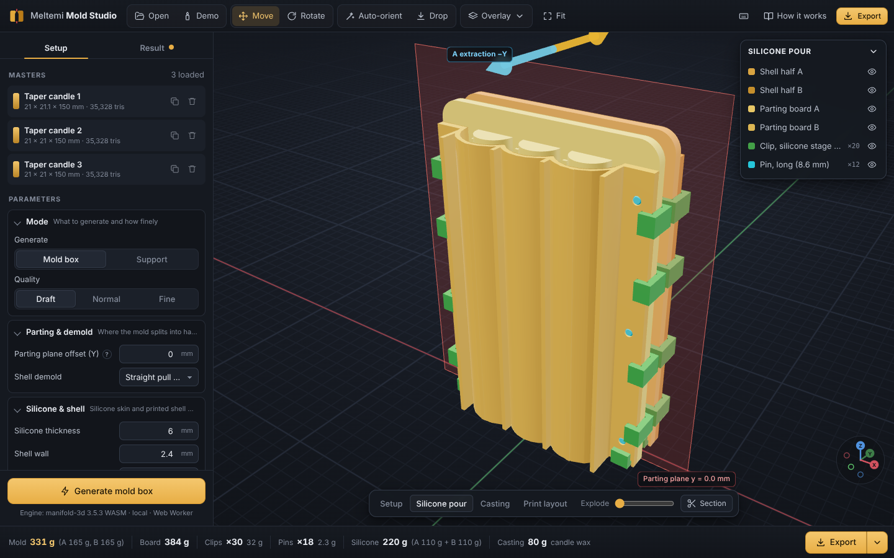
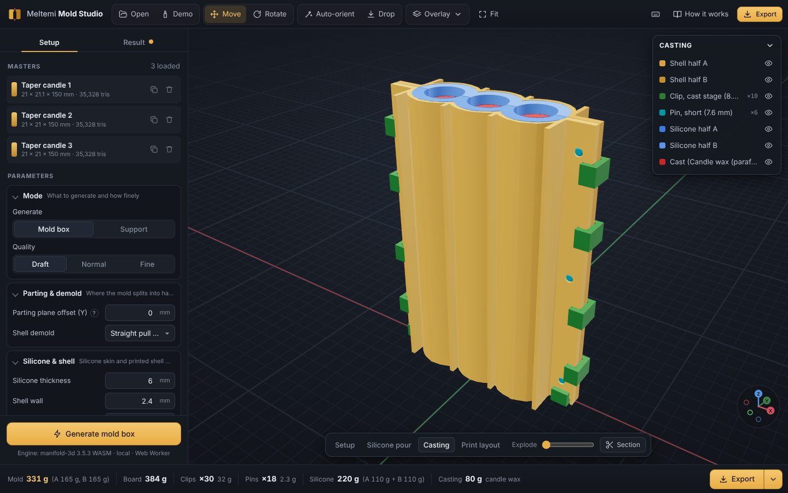

# Meltemi Mold Studio

| Silicone pour setup | Casting setup |
|---|---|
|  |  |


**Turn a 3D model into a print-ready mold box — and print supports for the silicone form you
pour in it.** Runs entirely in the browser (three.js + manifold-3d WASM, nothing is uploaded) and
as a Node CLI / library. Plain ES modules, no build step.

```
master (STL)  ──►  printed mold box (shells A/B, parting board, pins, clips)  ──►  pour silicone
                                                                                     │
finished casts ◄── pour wax / resin / plaster ◄── printed support (mother mold) ◄────┘
```

## Why a printed mold box?

**Molding** makes a negative of an object: you pour a liquid rubber (usually platinum-cure
silicone) around a *master* (the positive) and let it cure into an elastic **form**.
**Casting** fills that form with the final material — candle wax, resin, plaster, soap, concrete,
chocolate — and pops the copy out of the flexible silicone.

The silicone has to be poured into *something*: a box that holds it at a constant, economical
thickness around the master, splits along a parting line so the master and the casts come out,
registers the two halves precisely, and stays sealed. Hand-building that box from foam board and
hot glue is slow, wastes silicone (rectangular boxes leave thick corners), and leaks. A 3D-printed
box that follows the shape of the part (*conformal*) uses 2–4× less silicone, clamps with clips
instead of tape, and is reproducible. Afterwards the same rigid shell (or a lighter windowed
cage) holds the floppy silicone in shape while you cast — the **support** or *mother mold*.

That makes molding a practical **prototyping** tool: print one master, and make tens of copies in
real materials (wax, PU resin, food-safe silicone, plaster) that a printer can't produce directly.

## Features

* **Mold box from a master** (STL, several masters at once — e.g. three candles in one box):
  * conformal two-part **mother-mold shells** A/B at a constant silicone thickness, straight-pull
    demoldable, flat printable plinth, open top for the pour;
  * **flanges** with **alignment pin** holes, printed tapered **pins** (long set for the silicone
    pour, short set for casting) and **C-clips** with lead-in chamfers (two sandwich sizes);
  * external **ribs / feet** so each half stands upright and lies flat on its back;
  * **parting board** (double-sided, one pour for both halves — or two single-sided boards) that
    carries the half-reliefs of the master plus a **tongue-and-groove key ridge** around each cavity
    so the silicone halves self-register and seal;
  * **pour opening** (flat top face extended, or a funnel sprue at the highest point), optional
    **wick channel** for candles, automatic **air vents** above trapped pockets;
  * mass of every printed part, silicone volume + A/B mix weights, cast weight.
* **Support for an existing silicone form** (mode B): import the outer surface of a form you
  already have and get clamped mother-mold halves (optionally a windowed, lighter cage) with feet.
* Interactive 3D preview with assembly stages (silicone pour / casting), move & rotate gizmo,
  **auto-orient**, exploded view, export of a ZIP with all STLs + instructions.
* Node **CLI** for batch runs and CI; importers for **Fusion 360** and **Blender**.
* Built-in **demo**: three decorative taper candles with leafy vines and wax drips — the same
  scenario as the reference footage this app was designed from.

## Quick start

**Hosted:** https://julianvolodia.github.io/julianvolodia_meltemi/ (GitHub Pages, deployed by
`.github/workflows/pages.yml` on every push to `main`; everything runs in your browser, nothing is
uploaded).

Locally:

```bash
npm install            # manifold-3d, three, fflate (no other dependencies)
npm run serve          # -> http://localhost:8080  (static server, cli/serve.mjs)
```

Open the page, click **Demo candles** (or drop your STL), check orientation (Z = pour direction,
top = opening), press **Generate**, then **Export ZIP**. Any static host works too (GitHub Pages
etc.): off-localhost the page loads pinned library versions from jsDelivr. `npm run build:pages`
stages exactly what gets published (`index.html`, `src/`, `docs/img/`) into `_site/`.

GitHub Pages one-time setup: repository **Settings → Pages → Source: GitHub Actions**, and keep
`main` as the default branch (the `github-pages` environment only deploys the default branch).

Command line:

```bash
npm run cli -- --demo candles --out out/candles          # 3 candles, wick channels on
node cli/moldbox.mjs vase.stl --auto-orient --quality draft
node cli/moldbox.mjs part.stl --set siliconeThickness=6 --set boardStyle=single
node cli/moldbox.mjs form.stl --mode support --set cage=true --out out/support
node cli/moldbox.mjs --list-params                        # every parameter + default
```

The output folder holds `NN_<part>[_xQTY].stl` (print orientation), `preview/` (silicone, cast,
masters in the mold frame), `report.json` (parameters, masses, timings, warnings) and
`README.txt` (step-by-step instructions for this kit).

## The physical workflow

1. **Print** the kit: shells A and B (upright, as exported), the parting board, clips and pins.
2. **Release**: coat every surface that will touch silicone (shell insides, board, reliefs) with a
   release agent; seal FDM layer lines first if you want a glossy cast.
3. **Assemble for the silicone pour**: shell A | parting board | shell B, push the **long pins**
   through flanges and board, snap the **silicone clips** onto the flanges.
4. **Pour silicone** (mixed by weight, degassed if possible) into the open top in a thin stream
   into the lowest point; fill to the rim. The board's reliefs form each half's cavity and key.
5. **Cure** (Shore 10A–30A platinum silicone: typically 4–24 h), unclip, pull the halves off
   (±Y) and **remove the board**. Each shell still holds its silicone half — leave them in.
6. **Close for casting**: put the two shells (with silicone) back together face to face with the
   **short pins** and the **cast clips**. The keys lock the silicone halves together.
7. **Wick / sprue**: thread the wick through the wick channel, seal the bottom with putty.
8. **Pour** wax / resin / plaster into the opening, top up as it shrinks, let it set.
9. **Demold**: unclip, open the shells, peel the silicone off the cast. Repeat from step 6.

Details, materials, temperatures and troubleshooting: **[docs/WORKFLOW.md](docs/WORKFLOW.md)**.

## Parameter guide

All lengths in mm. The panel and `--list-params` show everything; these matter most:

| Parameter | Default | Recommended | Notes |
|---|---|---|---|
| `siliconeThickness` | 5 | 4–6 | thicker for soft silicone or big parts, 3 for tiny parts |
| `wallThickness` | 2.4 | 2.4 (6 perimeters × 0.4) | the shell is backed by ribs, it needs little wall |
| `flangeWidth` / `flangeThickness` | 14 / 4 | 12–18 / 3–5 | wider flanges → more room for pins and clips |
| `pinDiameter` / `pinClearance` | 3 / 0.25 | 3 / 0.2–0.3 | tune clearance to your printer |
| `clipInterference` | 0.15 | 0.1–0.3 | how much tighter than the sandwich the clip gap is |
| `boardStyle` | double | double | `single` = two flat-printable boards, two pours |
| `keys`, `keyWidth`, `keyHeight` | on, 1.8, 1.4 | on | tongue & groove between the silicone halves |
| `pourMode` | auto | auto | flat top → extend; pointy top → funnel sprue |
| `wick` / `wickDiameter` | off / 2.2 | on for candles | the CLI enables it for the candle demo |
| `vents` / `ventMinDepth` | on / 1.5 | on | vents every air pocket deeper than this |
| `demold` | straight | straight | `conformal` = least silicone but the shell may lock on undercuts |
| `quality` | normal | draft while iterating | voxel budget of the offset surfaces |

Materials & printing:

* **Silicone**: platinum-cure (addition) RTV, **Shore 10A–30A**; 10–15A for deep relief and
  undercuts, 25–30A for crisp large parts. Tin-cure works too (cheaper, shrinks more).
  Avoid sulfur-containing clays / some resins on the master (cure inhibition).
* **Print**: PLA or PETG, **0.2 mm layers**, **4–6 perimeters**, 15–25 % infill,
  **shells upright** exactly as exported (no supports needed — the flat plinth and the flange
  plane are printable), clips and pins flat. PETG for hot wax above ~60 °C contact or if the mold
  stays in a warm room.
* **Release**: Ease Release 200 or a thin film of vaseline on PLA; silicone does not stick to
  PLA/PETG chemically, but it locks into layer lines.

## Mode B — support for an existing form

If you already have a silicone form (made by hand, or bought), scan or model its **outer** surface
and import it with mode *Support for an existing silicone form*. The app builds clamped mother-mold
halves around it at `cageClearance` (0.3 mm) with flanges, pins, clips and feet — optionally a
lighter **windowed cage** (`cage`, `windowWidth`, `windowHeight`, `windowBar`) so you can see the
form and it cools faster.

## Architecture

```
src/core/            geometry (pure ESM; manifold-3d injected via wasm.js — runs in Node, workers, browser)
  params.js          DEFAULTS + PARAM_SCHEMA (drives the UI panel and --list-params)
  frame.js           mold frame helpers: plane extrude/slice/project, trims, mat4
  meshio.js          MeshData <-> Manifold (weld/repair), STL read/write
  sdf.js             voxelization, exact Euclidean distance transform, sweeps, level sets
  analysis.js        auto-orient (PCA + slice areas + silhouette), air traps (merge tree), pour mode
  features/          channels, shell, flanges, ribs, board, clips, pins, windows
  pipeline.js        generate() -> { parts, stats, frame, warnings, instructions }
src/ui/              three.js viewer, parameter panel, Web Worker, ZIP export
src/demo/            procedural candles and test primitives (pure JS MeshData)
cli/                 moldbox.mjs (CLI), serve.mjs (static server)
integrations/        Fusion 360 + Blender importers for the exported folder
```

How the geometry is made (full spec: **[docs/DESIGN.md](docs/DESIGN.md)**):

* **manifold-3d** (WASM) does every exact operation: booleans, extrusions, plane slices, volumes —
  its output is guaranteed manifold, so every exported STL is watertight.
* **Offsets of arbitrary meshes** (the silicone envelope, the shells) come from a voxel **signed
  distance field**: scan-line voxelization → exact separable **Euclidean distance transform**
  (Felzenszwalb–Huttenlocher) → **straight-pull sweeps** as prefix/suffix minima along ±Y (so each
  shell half slides off without rigid undercuts) and a downward sweep for the flat plinth →
  `Manifold.levelSet` surface extraction.
* **Planar faces that must mate** (parting plane, top rim, floor) are cut with exact
  `trimByPlane` booleans, never voxelized. Surfaces that touch the cast (the board reliefs) use the
  original master mesh, never a remesh.
* **Air vents**: a merge-tree / persistence sweep over the voxelized cavity from the top down
  (union–find, elder rule) finds every pocket that cannot drain its air to the opening.

## Testing

```bash
npm test               # node:test suites in test/*.test.mjs (Node 22)
```

The suites cover the frame helpers, SDF accuracy (sphere/box distances, voxel volume), air-trap
detection (an H-shaped cavity yields exactly one vent, a candle none), auto-orient, mesh I/O, the
feature modules (board, clips, pins, ribs, windows), the demo meshes (closed 2-manifold, outward,
`status() == NoError`), CLI argument parsing and the static server's path-traversal guard.
For a full end-to-end check run the CLI on the demo and open `out/candles/README.txt`.

## Limitations & roadmap

* Planar parting surface only (a single pull direction per half). Roadmap: stepped / freeform
  parting surfaces, multi-part (3+ piece) molds for parts with undercuts in every direction.
* Offset accuracy is limited by the voxel size (≈0.4–1 mm at *normal*); the cast surface itself is
  exact.
* Sprue and vent placement are automatic but not flow-simulated; draft analysis is not reported yet.
* Clip force is not computed — tune `clipInterference` for your material.
* No "cut mold" option (one-piece silicone block slit open with a knife) yet.
* Open questions and a review brief for stronger models: **[docs/ADVISOR_BRIEF.md](docs/ADVISOR_BRIEF.md)**.

## Credits & licenses

Meltemi Mold Studio is MIT-licensed. It builds on
[manifold-3d](https://github.com/elalish/manifold) (Apache-2.0),
[three.js](https://threejs.org) (MIT) and [fflate](https://github.com/101arrowz/fflate) (MIT).
Designed from an analysis of footage of a commercial printed-mold-box workflow; no code or assets
from that product are used.
